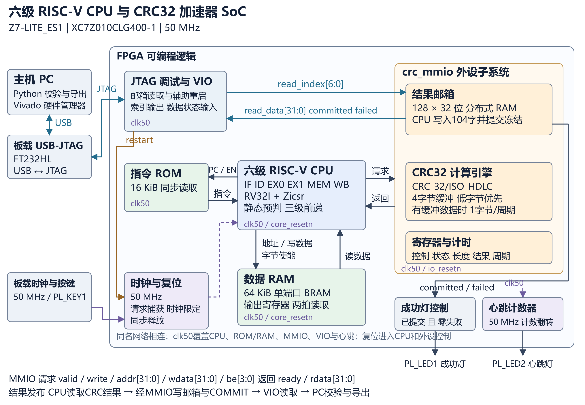

# 六级 RISC-V CPU 与 CRC32 硬件加速器

2026 嵌入式 FPGA 大赛 · FPGA 创新设计赛道 · AMD 自主选题初级组 · 团队编号 52052

自研六级 RV32I + Zicsr 处理器在 Z7-LITE_ES1 的可编程逻辑中运行裸机 C 程序，通过 MMIO 驱动 CRC-32/ISO-HDLC 加速器。主机通过 USB-JTAG/VIO 读取结果邮箱，独立重算 CRC，并导出完整调用周期与资源对比。



| 项目 | 配置 |
|---|---|
| FPGA / 板卡 | AMD XC7Z010CLG400-1 / Z7-LITE_ES1 |
| CPU | 六级顺序单发射，IF–ID–EX0–EX1–MEM–WB，RV32I + Zicsr |
| 系统时钟 | 50 MHz |
| 指令 / 数据存储 | 16 KiB ROM / 64 KiB RAM，独立访问通路 |
| 数据 RAM 地址 | `0x80100000–0x8010ffff`，字节使能、BRAM 输出寄存器、两拍读取 |
| CRC | CRC-32/ISO-HDLC，反射多项式 `0xedb88320`，初值及最终异或 `0xffffffff` |
| 处理方式 | CPU 按字喂入，4 字节缓冲，缓冲有数据时每周期处理一个字节 |
| 结果读取 | JTAG/VIO，128 × 32 位邮箱，提交后冻结 104 字记录 |

## 实测结果

正式上板记录包含三次 VIO 辅助复位、每轮正向/反向各一次 104 字扫描，12 组 × 3 轮共 36 组 CRC 全部匹配，错误计数均为 0。另附最近一次完整三轮演示的原始扫描和 Vivado 日志。

| 指标 | 软件查表 CRC | 硬件加速完整调用 |
|---|---:|---:|
| 4096 字节周期 | 69653 | 10295 |
| 4096 字节时间，50 MHz | 1393.06 µs | 205.90 µs |
| 加速比 | — | **6.765712×** |

硬件完整调用包括配置、CPU 搬运、轮询及读取结果。全部长度的数据均保留：0、1、2、3 字节用例的加速比低于 1，其固定开销可从 [完整性能表](evidence/agent_steps/step_06/performance/results.csv) 查看。

| 全 SoC 指标 | 软件基线配置 | 加速配置 |
|---|---:|---:|
| LUT | 6130 | 6560 |
| FF | 7694 | 7892 |
| BRAM Tile | 20 | 20 |
| DSP | 0 | 0 |

加速配置的 50 MHz 布线后 WNS / WHS / WPWS 为 +2.824 / +0.044 / +7.000 ns。资源差值是整个 SoC 两种配置的净差；原始资源、时序及基线说明见 [验证材料入口](docs/verification.md)。

## Skill 技能包

完整保留主工程的三个原生 Skill：[CPU 调试](skill/riscv-debug/SKILL.md)、[CPU 验证](skill/riscv-verification/SKILL.md)、[Vivado 自动化](skill/vivado-automation/SKILL.md)，并保留 CRC/MMIO 校验工具。原脚本、契约 TB、写回样例、验证记录和逐文件来源见 [Skill 总入口](skill/README.md)。

## 文档与结果入口

- [最终设计报告 PDF](report/design_report_official_template.pdf)
- [从零复现步骤](docs/reproduction.md)
- [板卡、供电与引脚](docs/hardware_setup.md)
- [CPU/MMIO/邮箱接口](docs/interface.md)
- [保存数据的核对与记录位置](docs/verification.md)
- [AI 协作与纠错记录](report/ai_collaboration.md)
- [可复用 Skill](skill/README.md)
- [本次发布范围与版本对应](docs/publication_notes.md)

## 先离线核对已有实测数据

Windows 10/11 x64，Python 3.12。克隆到新的可写目录：

```powershell
git clone https://github.com/LeonSKennedy125/z7-lite-riscv-cpu-crc32-52052.git D:\work\z7_crc32
Set-Location -LiteralPath 'D:\work\z7_crc32'
python -B -X utf8 skill/scripts/check_manifest.py --root . --manifest release_manifest.json
python -B -X utf8 scripts/verify_saved.py
python -B -X utf8 skill/scripts/verify_mailbox.py --self-test
```

预期依次得到 `MANIFEST_PASS`、`SAVED_EVIDENCE_PASS`、`SELFTEST PASS`。核对已保存数据无需连接板卡。

## 从源码构建

安装 Vivado **2026.1**，包含 7-series 支持及有效许可。xPack RISC-V GCC 固定 **15.2.0-1**，GCC 15.2.0；工具包 SHA-256 已固定在脚本和工具记录中。

```powershell
$env:CRC_DEMO_STANDALONE = '1'
$env:PYTHONDONTWRITEBYTECODE = '1'
$env:CRC_DEMO_VIVADO_BIN = 'D:/XILINX/2026.1/Vivado/bin'
# 已安装工具链时可设置：
# $env:CRC_DEMO_GCC_BIN = 'D:/tools/xpack-riscv-none-elf-gcc-15.2.0-1/bin'
python -B -X utf8 run.py toolchain
python -B -X utf8 run.py firmware
python -B -X utf8 run.py project
python -B -X utf8 run.py unit
python -B -X utf8 run.py memory
python -B -X utf8 run.py simulate
python -B -X utf8 run.py faults
python -B -X utf8 run.py controls
python -B -X utf8 run.py implement
python -B -X utf8 run.py project
python -B -X utf8 run.py report --source simulation
```

若未指定 GCC 路径，`toolchain` 会下载固定版本并核对哈希。`firmware` 检查指令、段布局、栈和镜像；`project` 生成七个 IP 及 `b/p/demo.xpr`；`implement` 生成新的实现结果。详细产物、命令顺序和预期终止标志见 [复现指南](docs/reproduction.md)。

## 在相同板卡上运行

准备 Z7-LITE_ES1、供电和 USB-JTAG，核对芯片及引脚版本；关闭其他 Hardware Manager 对该目标的连接。

```powershell
python -B -X utf8 board/runtime/run_board.py verify
python -B -X utf8 report/demo/demo_console.py --demo --runs 3
```

控制台使用仓库内与正式实测对应的 BIT/LTX，执行三轮复位、计算及邮箱扫描。每次新采集写入新的 `report/demo/runs_*` 目录。带设备身份记录的完整 preflight/capture 方法见 [板级运行说明](board/runtime/README.md)。

## 目录对照

| 赛事推荐目录 | 本仓库 |
|---|---|
| `src/` | `src/` RTL，`firmware/` 裸机 C、启动和链接 |
| `sim/` | `sim/` 测试台与 `sim/results/` 已有验证结果 |
| `build/` | `run.py`、`scripts/`、`build/README.md`；IP/实现结果由脚本生成 |
| `board/` | `board/runtime/` 下载产物和严格采集入口，`report/demo/` 演示控制台 |
| `data/` | `data/frozen/` 镜像与参考，`data/hardware/s05/` 正式实测原始资料 |
| `skill/` | 独立校验脚本、提示词模板、使用范围和示例 |
| `report/` | 最终 PDF、AI 记录、图表；其余性能与时序材料在 `evidence/` |

## 许可证

团队自研文件采用 [MIT](license.txt)，版权人：单枪匹马（范文轩、李元宏）。AMD 生成的结构化连接文件保留原版权头，AMD IP 由使用者的 Vivado 安装生成；对应条件及下载产物声明见 [第三方说明](third_party_notices.md)。
