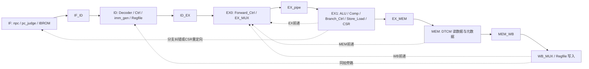

# 本核阶段、接口和分析依据

## 根据接线建立阶段图

实际接口来自主 `design_1.bd`，图只概括主数据方向。访存请求在EX1发起，BRAM延迟跨越EX1/MEM，不能套用组合RAM的五级流水图。

| 模块/文件 | 应核对的输入与输出 | 关键限制 |
| --- | --- | --- |
| Decoder/Ctrl | id_instr→rs1/rs2/rd、类型、ALU/Load/Store/WB控制 | 非零instr_valid只是气泡识别，不是完整非法编码检查 |
| Regfile | wen/w_addr/w_data与wb_addr/wb_data，final_data1/2 | x0不可写；旁路使能需有效写回 |
| ID_EX | stall/stall2/stall_Load、flush/csr_fluah、retain_en/data | 暂停可捕获已就绪旁路，元数据保持；同步复位 |
| EX_Forward | 生产者rd、wb_en、instr_type及两个源地址 | 只在有效非零rd匹配时前递/暂停 |
| Forward_Ctrl | EX/MEM/WB有效、类型选择、ALU/load/PC4/CSR/IO数据 | EX优先；较旧load元数据不能覆盖年轻EX生产者 |
| EX_pipe | 操作数/控制→EX1；load_over、instr_valid、csr_irq_safe | flush/CSR、stall_Load、Flush3不同优先级；两拍load不能提前解除 |
| MEM_WB | save/stall/flush，Forward_valid与Wen_out | save保留载荷与旁路有效，同时暂缓提交；不能重复提交 |
| Branch_Ctrl | instr_TYPE、Alu_out、comp_out、ex_pc/ex_pc4、Exception | BTFNT纠错；JALR清bit0；Exception抑制普通分支flush |
| pc_judge/npc | J_B、EM、replay_redirect、Pre、stall/load | 仲裁代码J_B在EM前，但Branch_Ctrl在异常时已抑制J_B；不能凭单个模块顺序改成通用优先级 |
| Store_Load | MEM_Addr/D2、load_over、IO_ready、valid/stall/cancel | RAM与三个MMIO地址分离；MMIO请求只有valid且未cancel才有效 |
| MEM_DTCM | ex_addr发起、mem_addr格式化、ena/wea/dout | 65536×32，primitive output register，边界外无RAM访问 |
| csr_top/Regfile | opcode/rs1/uimm、instr_valid/irq_safe、sys_stall/sys_exception | CSR机器模式子集；单元可注入IRQ但主顶层未接IRQ输入 |

## 定位实际文件

手写主RTL：`RISCV_5pipeline.srcs/sources_1/new/`；CSR：`sources_1/imports/vivado-file/`；主BD：`sources_1/bd/design_1/design_1.bd`。生成wrapper不作为永久修复文件；静态清单保存主BD所有网络供追踪。

不能把同级 `rv32_m.bd` 当成主实例。主design_1没有M/TAGE/BHT实例，也没有证据支持Cache、DMA或AXI。需要扩展时另列“可选扩展”，重新定义ISA和验证矩阵后才接入。

ROM深度4096×32，复位PC0x80000000；地址索引只取pc[13:2]，地址别名/访问权限没有由此解决。RAM有效范围0x80100000..0x8013ffff；MMIO精确地址0x80200020/40/50。

## 版本与证据

先查XPR/BD、运行中Vivado版本和输入hash。历史报告的正WNS不能证明刚改过的RTL；旧路径中的生成代码也不能替代活动工程。模块结果、全核记录复核、新仿真、时序与板级实测分开标识。

本轮静态清单和模块/trace检查可验证这里列出的结构与指定行为；没有本轮全核新仿真、综合、实现或板级验证。原主核系统桥和外部接口条件仍需资料。
